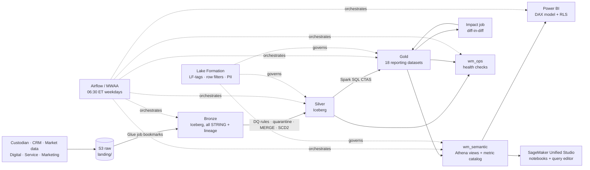

# Wealth Management Performance Lakehouse on AWS

An end-to-end AWS project for a Wealth Management reporting and analytics team:
**standardized reporting datasets → semantic layer → Power BI → incremental-impact
measurement → self-serve analytics**. It is built with **S3, AWS Glue (PySpark), Apache
Iceberg on the Glue Data Catalog, Amazon Athena, Lake Formation, Apache Airflow (MWAA),
SageMaker Unified Studio and Power BI**, and deployed with **Terraform** and GitHub Actions.

It runs on realistic synthetic data for a Canadian wealth division: 17 upstream feeds,
registered plans (RRSP, TFSA, RESP, RRIF, FHSA), advisor → branch → region hierarchies,
custodian re-sends and restatements, and two randomized campaigns with known effects. Every
number can therefore be checked against ground truth.

> **How the project maps to the role:** see [`docs/requirements_traceability.md`](docs/requirements_traceability.md).
> **Coming from the Databricks version?** See [`docs/databricks_to_aws.md`](docs/databricks_to_aws.md).

## Architecture



## What's inside

| Layer | AWS services | Highlights |
|---|---|---|
| **Landing** | S3 (KMS, versioning, lifecycle) | One prefix per feed. A generator job stands in for the source systems |
| **Bronze** | Glue 5.0 PySpark, job bookmarks, Iceberg | Incremental file pickup. Everything stored as STRING with lineage columns. Schema evolution on append |
| **Silver** | Glue PySpark, Iceberg `MERGE INTO` | Table-driven specs. DQ rules route failures to quarantine tables with the rule names. Re-sends and restatements resolve latest-wins (SCD1). Advisors, households and clients keep SCD2 history. Watermarks |
| **Gold** | Glue Spark SQL, Iceberg CTAS | 18 datasets: AUM bridge, TWR / Modified Dietz, daily AUM with as-was branch, household 360, advisor balanced scorecard, service quality, digital, campaign panel |
| **Semantic** | Athena views, metric catalog table | Business-friendly views and certified ratio-of-sums KPIs. The only layer BI users can read |
| **BI** | Power BI (Athena connector) | Star schema, certified DAX measures (semi-additive AUM, fiscal YTD), RLS by advisor book, refresh triggered by Airflow |
| **Impact analytics** | Glue job + SageMaker Unified Studio | Household difference-in-differences with bootstrap CIs, pre-trend check, quality guardrails. Interactive explorer notebook |
| **Operations** | Airflow (MWAA), EventBridge, SNS, CloudWatch | Daily DAG with a Monday branch. Health checks block the Power BI refresh on critical failures. Alerts on any Glue failure |
| **Governance** | Lake Formation, KMS, IAM | LF-tags by layer and classification, PII columns excluded, row filters per advisor, TLS-only buckets |
| **Delivery** | Terraform, GitHub Actions (OIDC) | dev/test/prod. Tests run the real silver logic and gold SQL locally against ground truth |

## Repository layout

```
src/wm_common/            shared library shipped to Glue as wm_common.zip
  generator.py            synthetic source systems (deterministic, append-only)
  silver.py               bronze/silver logic: specs, typing, DQ split, SCD2, MERGE statement
  transforms.py quality.py metrics.py impact.py health.py sqlrunner.py glue_runtime.py
  sql/gold/*.sql          gold Iceberg CTAS statements (Spark SQL)
  sql/athena/*.sql        Athena semantic views (Trino SQL)
  sql/metric_catalog.yml  certified metric definitions
glue_jobs/                7 Glue job scripts (generate, bronze, silver, gold, health, semantic, impact)
airflow/dags/             wm_daily_reporting, wm_bootstrap
powerbi/                  model spec, DAX measures, RLS roles
sagemaker/                Unified Studio setup + impact explorer notebook
infra/terraform/          S3, KMS, Glue, IAM, Athena, Lake Formation, SNS/EventBridge, MWAA
tests/                    unit + local end-to-end tests (no AWS needed)
docs/                     architecture, traceability, runbook, metrics, Databricks→AWS mapping
```

## Quick start

```bash
# 1. Local: Python 3.10+ and Java 17+
pip install -e ".[dev]"
pytest                                   # 39 tests, about 1 minute, no AWS account needed

# 2. AWS (ca-central-1 by default)
cd infra/terraform
cp envs/dev.tfvars.example envs/dev.tfvars              # fill in your account ID and email
cp envs/dev.backend.hcl.example envs/dev.backend.hcl
terraform init -backend-config=envs/dev.backend.hcl
terraform apply -var-file=envs/dev.tfvars
# 3. Trigger the Airflow DAG wm_bootstrap (config {"scale": "small"}), then unpause wm_daily_reporting
```

Full steps are in [`docs/runbook.md`](docs/runbook.md).

## Verified results (synthetic data, local harness)

* **Performance math is exact.** Daily and monthly TWR match the simulated true returns to within 1e-9.
* **Controls hold.** The AUM bridge closes, month N end equals month N+1 begin, holdings reconcile to valuations, silver has zero duplicate keys after re-sends, and every CRITICAL health check passes.
* **Semantic layer runs.** Every Athena view parses as Trino SQL and executes against the gold tables (transpiled with sqlglot).
* **Impact recovers the injected effects** (`small` preset): consolidation outreach lifts net flows by about $12.8K per household per month (95% CI $4.4K to $20.1K) with no change in complaints. The digital nudge lifts sessions by about 40% and correctly shows no effect on flows.

## What is tested where

* **Tested locally:** the generator, bronze/silver functions, DQ rules, every gold SQL statement, the health checks, the Athena views, the impact estimator, and the contracts between Terraform, Glue scripts and Airflow DAGs. `terraform fmt` passes.
* **Needs an AWS account:** Glue DynamicFrame bookmarks, Iceberg MERGE and CTAS on the Glue catalog, Lake Formation grants, MWAA, Power BI and Unified Studio. These use documented AWS APIs but haven't been run against a live account from this repository. Run `terraform validate` in CI (provider download needed).
