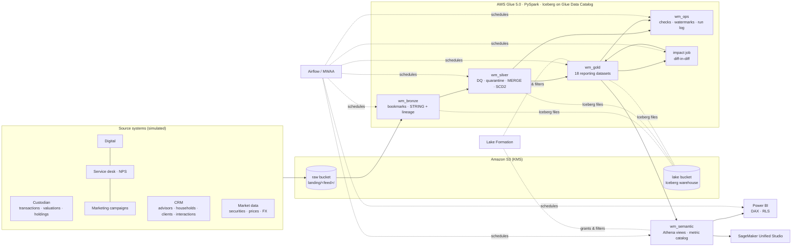
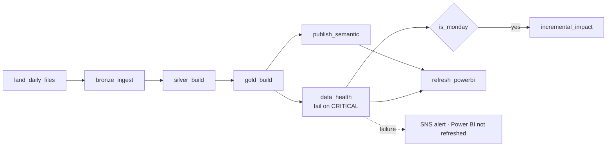

# Architecture (AWS)

## End to end

## Daily DAG (`wm_daily_reporting`, 06:30 America/Toronto, Mon–Fri)

## Design decisions

| # | Decision | Why | Trade-off |
|---|---|---|---|
| 1 | **Iceberg on the Glue Data Catalog** for every layer | ACID MERGE, atomic CTAS, time travel, schema evolution. Readable by Athena and Power BI | Needs periodic compaction and snapshot expiry |
| 2 | **Glue job bookmarks** for bronze | Native incremental S3 pickup, no extra state store | Bookmarks commit per job, so a partial failure re-reads (handled by silver MERGE) |
| 3 | **Bronze = STRING + lineage** | Upstream type drift can't break ingestion. Full audit trail back to the file | Silver must type everything, which is centralized in `silver.py` |
| 4 | **Table-driven silver specs** | One job, 17 entities, four load patterns. Adding a feed is config plus a standardizer | Less flexible for one-off logic |
| 5 | **MERGE latest-wins + watermarks** for facts | Idempotent re-runs. Custodian re-sends and restatements resolve correctly | The watermark table is state that must be protected |
| 6 | **SCD2 rebuilt from events** for small masters | Always consistent with bronze history, self-healing, simple | Rebuild cost grows with events (fine for thousands of advisors and households) |
| 7 | **Gold as Spark SQL CTAS files** | SQL is reviewable by analysts, reused verbatim by the local tests, and atomic on Iceberg | Full rebuild per run. Large facts can move to incremental MERGE |
| 8 | **Athena views + DAX** as the semantic layer | Power BI stays the business tool. Views give SQL users the same certified inputs | Definitions exist in two languages. The metric catalog plus a contract test keeps them aligned |
| 9 | **Health checks gate the BI refresh** | Wrong numbers never reach executives | A late feed delays the whole refresh (by design) |
| 10 | **Lake Formation LF-tags** | Grants follow `layer` / `classification` / `pii` tags, not table lists | Table-level filters need the tables to exist (enabled after bootstrap) |
| 11 | **EventBridge → SNS** alongside the Airflow callbacks | Alerts still fire if Airflow itself is unhealthy | Possible duplicate alerts |
| 12 | **Pure functions + local Spark tests** | The silver and gold logic is verified in CI without AWS | Glue-only features (DynamicFrame, Iceberg MERGE) are verified in the dev smoke run |

## Security

* KMS CMK for S3, Glue logs, bookmarks, Athena results, SNS, Secrets Manager and MWAA. Buckets enforce TLS and block public access.
* The Glue role is scoped to `wm_*` databases and the project buckets. Lake Formation vends credentials.
* Personas: engineers (LF admins), analysts and Unified Studio projects (`layer ∈ {gold, semantic, ops}` and `pii=false`), the Power BI gateway (`layer = semantic`, `pii=false`), and advisors (data cells filter on `advisor_id`).
* Power BI RLS uses `wm_semantic.advisor_access_map` with `USERPRINCIPALNAME()`.
* Data residency: `ca-central-1` by default.
